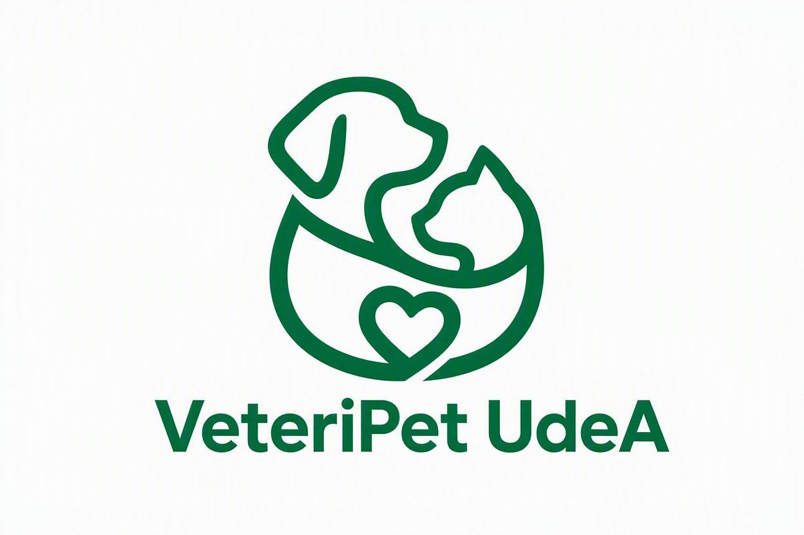

# VeteriPet-PQRS-UdeA.

## 1. Integrantes
- **Nayeli Vergara Mazo** (Líder del Proyecto) – Apasionada por la fotografía urbana, la lectura y las caminatas al aire libre. Interesada en la apreciación cultural y el aprendizaje constante.
- **Maximiliano González López** – Me considero una persona muy alegre. Me gusta demasiado el Baloncesto ya que me permite liberarme y hacerme sentir en paz conmigo mismo. También disfruto ir al gimnasio para despejar la mente.

## 2. Vínculos Académicos y Descripción

- **Nayeli Vergara Mazo**
  * **Programa:** Ingeniería Industrial (Universidad de Antioquia)
  * **Habilidades y Fortalezas:** Observadora, con gran capacidad de análisis y atención al detalle. Me caracteriza la disciplina, el gusto por el orden, la gestión en GitHub y la constancia en lo que me propongo.

- **Maximiliano González López**
  * **Programa:** Ingeniería Industrial (Universidad de Antioquia)
  * **Habilidades y Fortalezas:** Tengo mucha responsabilidad y la habilidad de aprender muy rápido, en especial sobre programación en Python y lógica de algoritmos. Soy aplicado y estoy dispuesto a aprender cosas nuevas cada día.

## 3. Nombre del Proyecto, Descripción y Logo

- **Nombre Oficial:** VeteriPet UdeA.
- **Descripción:** Sistema de información de consola desarrollado en Python para la recepción, seguimiento, gestión y generación de estadísticas de Peticiones, Quejas, Reclamos y Sugerencias (PQRS) de atención veterinaria de caninos y felinos para VeteriPet de la Universidad de Antioquia.

  

## 4. Licencia del Software

    VeteriPet-PQRS-UdeA. © 2026 de Nayeli Vergara Mazo y Maximiliano González López tiene licencia CC BY-NC-SA 4.0. Para ver una copia de esta licencia, visite https://creativecommons.org/licenses/by-nc-sa/4.0/

## 5. Reporte de Visión

### Descripción General del Software
**VeteriPet UdeA** es un programa estructurado desarrollado en Python con interfaz de consola (CLI), diseñado para gestionar, registrar, organizar y consultar las Peticiones, Quejas, Reclamos y Sugerencias (PQRS) recibidas para la atención veterinaria de mascotas en la comunidad universitaria.

El sistema permite capturar los datos del usuario solicitante, la información detallada de la PQRS, su estado y el cálculo automático de la fecha máxima de respuesta. La información se almacena de manera organizada y permanente mediante cuatro archivos de texto plano independientes, garantizando una solución liviana, funcional y sin costos de licenciamiento.

### Objetivos del Proyecto
- **Objetivo General:** Implementar un sistema informático funcional en Python para la gestión, control y seguimiento eficiente de las PQRS en VeteriPet UdeA.
- **Objetivos Específicos:**
  * Estructurar el registro estandarizado de datos del solicitante, detalles de la mascota (Perro/Gato) y cálculo automático de fechas límite de respuesta (30 días calendario).
  * Facilitar la consulta en tiempo real del estado de las solicitudes para el control y seguimiento continuo por parte del equipo.
  * Garantizar la persistencia de datos almacenando la información de forma independiente en archivos de texto (Peticion.txt, Queja.txt, Reclamo.txt, Sugerencia.txt).
  * Consolidar métricas para la generación de reportes y estadísticas de gestión.

### Beneficios
- **Para la Organización (VeteriPet UdeA):** Centralización de la información, eliminación del procesamiento manual a papel y lápiz, control de tiempos de atención y facilidad de mantenimiento del software.
- **Para los Usuarios:** Proceso de radicación transparente, generación de comprobante impreso en texto ASCII, trazabilidad del caso y respuesta oportuna a sus requerimientos.

## 6. Especificación de Requisitos

### 6.1 Requisitos Funcionales

1. **Registro de PQRS:** El sistema debe permitir registrar una nueva solicitud capturando los datos del solicitante, la información del caso, la mascota y el campus.
2. **Radicado Automático:** El sistema debe asignar automáticamente un ID de registro (número entero auto-incremental comenzando en 1) por cada tipo de archivo de manera independiente.
3. **Clasificación de Solicitud:** El sistema debe permitir seleccionar la categoría exacta de la solicitud: Petición, Queja, Reclamo o Sugerencia.
4. **Validación Rigurosa del Solicitante:** El sistema debe validar que el nombre no contenga números ni caracteres especiales no autorizados; el tipo de documento sea válido (CC, TI, CE, PP, NIT); el número de documento tenga entre 3 y 15 dígitos; el teléfono tenga exactamente 10 dígitos; y el correo cumpla la estructura con un único símbolo @ y dominio válido.
5. **Detalles y Canales:** El sistema debe permitir registrar la fecha de radicación, el canal de recepción (Presencial, Correo, Web, Teléfono, Redes, Otro), el asunto/título y la descripción detallada del caso.
6. **Información Relacionada:** El sistema debe registrar obligatoriamente el tipo de mascota (exclusivamente Perro o Gato) y el campus universitario de la UdeA asociado.
7. **Gestión Automática de Tiempos:** El sistema debe calcular la fecha máxima de respuesta sumando automáticamente 30 días calendario a la fecha de radicación utilizando la librería datetime.
8. **Flujo de Estados:** El sistema debe asignar la solicitud con estado inicial "Registrada" y controlar los cambios de estado siguiendo estrictamente la secuencia: Registrada -> En proceso -> Solucionada.
9. **Persistencia en Archivos Independientes:** El sistema debe almacenar de forma permanente los registros en 4 archivos de texto independientes según su tipo (Peticion.txt, Queja.txt, Reclamo.txt, Sugerencia.txt).
10. **Consulta de Registros:** El sistema debe permitir consultar las PQRS activas y filtrar la información registrada para su seguimiento.
11. **Impresión de Radicado ASCII:** El sistema debe imprimir o generar un comprobante/radicado en formato de texto ASCII delimitado con marco (+, -, |), centrado y con un ancho horizontal fijo de exactamente 120 caracteres.
12. **Módulo de Estadísticas:** El sistema debe calcular y presentar 5 estadísticas clave de gestión, incluyendo de forma obligatoria el promedio en días enteros de tiempo de respuesta a las PQRS.

### 6.2 Requisitos No Funcionales

1. **Lenguaje de Desarrollo:** El sistema debe estar desarrollado en el lenguaje de programación Python (versión 3.10 o superior).
2. **Interfaz CLI Usable:** El programa funcionará mediante un menú interactivo en consola de comandos (CLI) limpio, accesible y fácil de operar para el usuario administrador.
3. **Arquitectura Modular:** El código debe estructurarse modularmente dividiendo las responsabilidades en la carpeta `/src` con archivos específicos: `validaciones.py`, `archivos.py`, `reportes.py` y el script principal.
4. **Programación Orientada a Objetos:** El programa implementará clases y objetos para modelar la información, utilizando la convención del prefijo 'c_' en los nombres de las clases.
5. **Comprensión de Listas:** Se deben utilizar mecanismos eficientes de Python como la comprensión de listas para la manipulación y filtrado de datos.
6. **Documentación y Comentarios:** El código debe contener comentarios explicativos para asegurar mantenibilidad y claridad.
7. **Integridad de Datos:** La manipulación de archivos planos debe asegurar la no duplicidad de ID y gestionar correctamente los campos opcionales asignando "N/A" cuando corresponda (como en la dirección).

## 7. Plan de Proyecto

### 7.1 Actividades del Proyecto

1. Analizar el problema y comprender los requerimientos del proyecto.
2. Definir los datos que se deben registrar para cada PQRS y estructurar la información.
3. Diseñar la arquitectura del programa con POO (clases 'c_') y la persistencia en archivos de texto planos.
4. Diseñar el módulo de validaciones de datos (`validaciones.py`).
5. Desarrollar el módulo de registro de las PQRS en 4 archivos independientes (`archivos.py`).
6. Desarrollar la funcionalidad de consulta, actualización de estados y comprobante ASCII de 120 caracteres.
7. Desarrollar el módulo de reportes y estadísticas de gestión (`reportes.py`).
8. Realizar pruebas integrales del programa y corregir errores de ejecución.
9. Elaborar la documentación final, el plan de versionado y el manual de usuario.
10. Organizar el repositorio y realizar las entregas continuas en GitHub.

### 7.2 Cronograma (Diagrama de Gantt)

El proyecto se distribuye a lo largo de las 16 semanas del semestre académico:

| Actividad | Semana 1-2 | Semana 3-4 | Semana 5-6 | Semana 7-8 | Semana 9-10 | Semana 11-12 | Semana 13-14 | Semana 15-16 |
| :--- | :---: | :---: | :---: | :---: | :---: | :---: | :---: | :---: |
| 1. Análisis de requerimientos y Actas | **X** | | | | | | | |
| 2. Identidad (**VeteriPet UdeA**), Logo y Licencia | | **X** | | | | | | |
| 3. Diseño de validaciones y estructuración de datos | | | **X**| | | | | |
| 4. Plan de Proyecto y Presupuesto (**Entrega 1 - Semana 8**) | | | | **X** | | | | |
| 5. Desarrollo de POO (c_) y registro de PQRS | | | | | **X** | | | |
| 6. Módulo de archivos planos (archivos.py) y consultas | | | | | | **X** | | |
| 7. Comprobante ASCII (120 char) y estadísticas (reportes.py) | | | | | | | **X** | |
| 8. Pruebas, Manual de Usuario y Sustentación (**Entrega 2 - Semana 16**) | | | | | | | | **X** |

### 7.3 Presupuesto del Proyecto

El presupuesto se liquida en tiempo de práctica de formación profesional, valorado a la tarifa de 1 Salario Mínimo Legal Vigente (SMLV 2026).

- **Equipo de trabajo:** 2 estudiantes de Ingeniería Industrial (Nayeli Vergara Mazo y Maximiliano González López).
- **Tiempo por estudiante:** 50 horas invertidas en el desarrollo del proyecto.
- **Total de horas acumuladas:** 100 horas del equipo ($2 \text{ integrantes} \times 50 \text{ horas}$).
- **Valor hora de práctica (Base 1 SMLV 2026 / 210 hrs mensuales):** $8.338 COP / hora.

| Fase del Proyecto | Horas por Integrante | Horas Totales del Equipo | Valor Hora (COP) | Costo Total Estimado (COP) |
| :--- | :---: | :---: | :---: | :---: |
| **Análisis, Actas y Planificación (Puntos 1 a 4)** | 10 hrs | 20 hrs | $8.338 | $166.760 |
| **Diseño POO y Módulo de Validaciones (validaciones.py)** | 10 hrs | 20 hrs | $8.338 | $166.760 |
| **Desarrollo de Persistencia y Archivos (archivos.py)** | 15 hrs | 30 hrs | $8.338 | $250.140 |
| **Generación de Radicado ASCII y Estadísticas (reportes.py)** | 10 hrs | 20 hrs | $8.338 | $166.760 |
| **Manual de Usuario, Pruebas y Sustentación Final** | 5 hrs | 10 hrs | $8.338 | $83.380 |
| **TOTAL GENERAL DEL PROYECTO** | **50 hrs** | **100 hrs** | **N/A** | **$833.800 COP** |

\n## 8. Plan de Versionado y Control de Cambios

Para garantizar un desarrollo ordenado y trazable del software **VeteriPet UdeA - Gestor de PQRS**, el equipo implementará el siguiente esquema de versionado semántico (`vX.Y.Z`):

| Versión | Fecha Estimada | Entregable | Descripción de Cambios y Alcance |
| :---: | :---: | :--- | :--- |
| **v0.1.0** | 19/08/2026 | Propuesta Inicial | Estructuración inicial del repositorio y definición del alcance del proyecto (Entrega 1). |
| **v0.2.0** | 12/10/2026 | Reestructuración de Equipo | Formalización de la transición a equipo de 2 integrantes, actualización de licencias, actas y carpeta `/docs`. |
| **v1.0.0** | 26/10/2026 | Módulo de Entrada y Validación | Implementación de `validaciones.py` para la captura y verificación rigurosa de fechas, correos UdeA y prioridades. |
| **v1.1.0** | 09/11/2026 | Persistencia en Archivos | Desarrollo de `archivos.py` para lectura/escritura de PQRS en archivos planos `.txt` de la carpeta `/data`. |
| **v1.2.0** | 23/11/2026 | Módulo de Reportes Estadísticos | Implementación de `reportes.py` para el cálculo de estadísticas y generación de informes en consola. |
| **v2.0.0** | 07/12/2026 | Producto Final (Entrega 2) | Integración total en `main.py`, comprobante ASCII, manuales terminados y versión estable para sustentación. |
