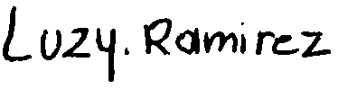

**ACTA DE ACEPTACIÓN DE DISOLUCIÓN DE GRUPO Y CONTINUACIÓN  DE TRABAJO INDEPENDIENTE** 

**Proyecto:** Gestor de PQRS \- VeteriPet UdeA 

**Curso:** Algoritmia y Programación 

**Fecha:** 13de octubre de 2026 

**1\. OBJETIVO** 

Dejar constancia formal de que las integrantes firmantes aceptan la disolución del equipo de trabajo  inicial del proyecto "VeteriPet UdeA" y de que continuarán el desarrollo del proyecto de manera  independiente para la fase de programación (Entrega 2). 

**2\. INTEGRANTES DEL GRUPO INICIAL** 

• Nayeli Vergara Mazo 

• Maximiliano González López 

• Luz Yadira Ramírez Rojas 

• Brianda Isabel Saenz Llorente 

• Aura Jhosceline Hurtado Botero 

**3\. ANTECEDENTES** 

1\. Mediante el "Acta de Disolución de Grupo y Constitución de Nuevo Equipo", fechada el 12 de  octubre de 2026 y firmada por Nayeli Vergara Mazo y Maximiliano González López, se dio por  disuelto el equipo inicial de cinco integrantes y se constituyó un nuevo grupo de dos integrantes  para la fase de programación. 

2\. Dicha acta indica que la disolución fue consultada con el docente de la asignatura, quien dio su  aval para reestructurar el trabajo a partir de la Entrega 2 y mantener el registro de la Entrega 1  tal como se presentó. 

3\. Las integrantes que suscriben la presente acta no firmaron el documento mencionado. 

**4\. POSICIÓN DE LAS INTEGRANTES FIRMANTES** 

1\. Las firmantes **aceptan la disolución** del grupo original de cinco integrantes. 2\. Las firmantes **no comparten las razones** expuestas en el acta de disolución como justificación de  esta decisión. 

3\. No obstante, con ánimo de prudencia y para evitar controversias innecesarias, las firmantes no  controvierten el contenido de dicha acta y aceptan lo allí dispuesto en cuanto a la disolución.  Esta aceptación se hace únicamente para efectos de la disolución y no implica reconocer como  propias las razones expuestas. 

4\. Las firmantes dejan constancia de que **continuarán con su trabajo por aparte**, desarrollando de  forma independiente la fase de programación, los módulos de código y la Entrega 2 del curso.  
**5\. ACUERDOS Y DISPOSICIONES FINALES** 

1\. **Cierre de la Entrega 1:** Se respeta y consolida la Entrega 1 realizada por el grupo inicial de cinco  integrantes, tal como fue presentada. 

2\. **Disolución del grupo original:** Se da por finalizada la colaboración del equipo de cinco  integrantes para las etapas posteriores. 

3\. **Conformación del equipo independiente:** Luz Yadira Ramírez Rojas, Brianda Isabel Saenz  Llorente y Aura Jhosceline Hurtado Botero continuarán el proyecto como un equipo de trabajo  independiente, con su propio repositorio, código y entrega. 

4\. **Reconocimiento de autoría:** Las firmantes reconocen la autoría del grupo inicial sobre los  documentos de la Entrega 1, y el trabajo posterior conservará el crédito correspondiente a sus  integrantes, conforme a la licencia del proyecto (CC BY-NC-SA 4.0). 

5\. **Conocimiento del docente:** La presente acta se pone en conocimiento del docente de la  asignatura para su registro. 

**6\. REGISTRO Y FIRMAS** 

| Nombre completo  | Documento  | Firma |
| :---- | :---- | ----- |
| Luz Yadira Ramírez Rojas  | 43.908.906 |  width="200" |
| Brianda Isabel Saenz Llorente  | 1.045.508.755 |  |
| Aura Jhosceline Hurtado Botero  | 1.036.395.089 |  |

**Estado:** Pendiente de registro por el docente del curso.

