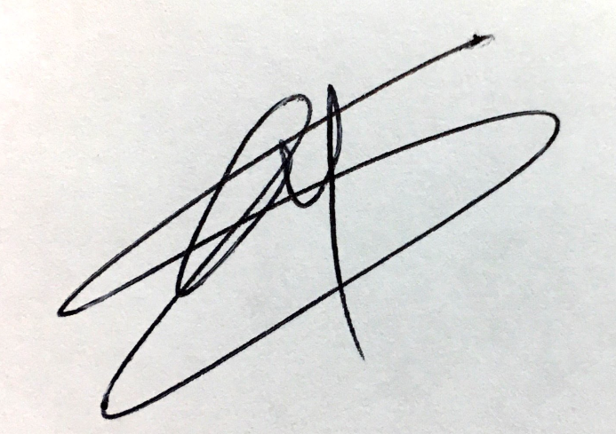

# Acta de Colaboración

**Proyecto:** Gestor de PQRS - VeteriPet UdeA

**Curso:** Algoritmia y Programación 2026-2

**Fecha:** _(20/08/2026)_

## 1. Objetivo

Especificar las metodologías de trabajo en equipo, los canales y frecuencia de comunicación, y las
estrategias de resolución de conflictos que regirán el desarrollo del proyecto.

## 2. Canales de comunicación

| Canal | Uso previsto |
|---|---|
| _(WhatsApp)_ | Comunicación rápida del día a día. |
| _(GitHub)_ | Seguimiento de tareas y avances técnicos. |
| _(reuniones virtuales)_ | Reuniones semanales de seguimiento. |

## 3. Frecuencia de comunicación y reuniones

- Reunión de seguimiento: _(semanal, todos los jueves 8:00 p.m.)_
- Tiempo máximo de respuesta a un mensaje del equipo: _(24 horas)_

## 4. Metodología de trabajo

Trabajaremos bajo un enfoque ágil simplificado:

1. El docente actúa como *Product Owner* (PO); el equipo debe agendar asesoria para aclarar requisitos de entrega o dudas relacionadas con el desarrollo de alguno de los puntos.
2. Las tareas se dividen por módulo (`validaciones.py`, `archivos.py`, `reportes.py`, `main.py`,
   documentación) y se asignan según las fortalezas de cada integrante (ver Acta de
   Responsabilidad).
3. Cada avance relevante se registra como una nueva versión en `docs/plan_versionado.md` y se sube
   al repositorio de GitHub.

## 5. Normas de trabajo en equipo

- El código y la documentación se revisan entre todos antes de subirlos a la rama principal.
- Las decisiones de diseño se toman por consenso; si no hay consenso, se somete a votación entre los
  integrantes presentes en la reunión.

## 6. Resolución de conflictos

1. En caso de desacuerdo, se recurre primero al diálogo directo entre las partes involucradas.
2. Si no se llega a un acuerdo, el conflicto se discute en la siguiente reunión de seguimiento con
   todo el equipo.
3. Si aun así no se resuelve, se consulta al docente del curso para mediación, tal como lo establece
   el procedimiento del proyecto.

## 7. Exclusión o expulsión de integrantes

Un integrante podrá ser reportado al docente si incumple reiteradamente (más de _2_ veces)
sus responsabilidades asignadas en el Acta de Responsabilidad, sin justificación válida y sin haber
comunicado el impedimento con anticipación.

## 8. Sanciones internas

_reasignación de tareas, reporte al docente._

## 9. Asistentes

| Nombre completo | Firma |
|---|---|
| _Nayeli Vergara Mazo_ | |
| _Luz Yadira Ramirez Rojasr_ | |
| _Brianda Isabel Saenz Llorente_ |  |
| _Maximiliano González Lopez_ | |
| _Aura Jhosceline Hurtado Botero_ |  |

