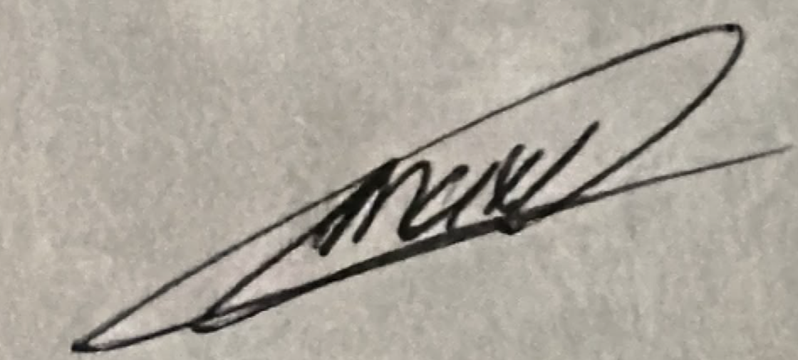

# Acta de Entendimiento

**Proyecto:** VeteriPet UdeA - Gestor de PQRS  
**Asignatura:** Algoritmia y Programación (2026-2)  
**Universidad:** Universidad de Antioquia - Facultad de Ingeniería  
**Integrantes:** Nayeli Vergara Mazo y Maximiliano González López  

## 1. Objetivo General
Desarrollar un sistema de información en consola utilizando Python para gestionar, registrar, consultar y generar reportes estadísticos sobre las Peticiones, Quejas, Reclamos y Sugerencias (PQRS) del Movimiento Estudiantil de Perritos y Gaticos (MEPEGA) en la Universidad de Antioquia.

## 2. Objetivos Específicos
* Construir una interfaz interactiva de consola amigable y con comprobante ASCII de registro.
* Implementar validaciones rigurosas para la captura de datos (fechas, correos, tipos de PQRS y prioridades).
* Garantizar la persistencia de datos mediante lectura y escritura en archivos planos de texto (`.txt`) ubicados en la carpeta `/data`.
* Generar estadísticas descriptivas completas sobre las PQRS procesadas.

## 3. Compromiso de Calidad y Trabajo Conjunto
Ambos integrantes nos comprometemos a diseñar, programar, probar y revisar de manera colaborativa la totalidad del proyecto, asegurando el dominio integral del código por parte de ambos.

## 4. REGISTRO Y FIRMAS

| Nombre Completo | Rol en el Proyecto | Firma |
| :--- | :--- | :---: |
| **Nayeli Vergara Mazo** | Líder de Proyecto & Gestión |  |
| **Maximiliano González López** | Desarrollador Principal & Lógica |  |

